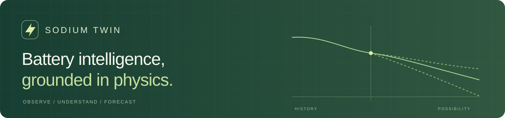
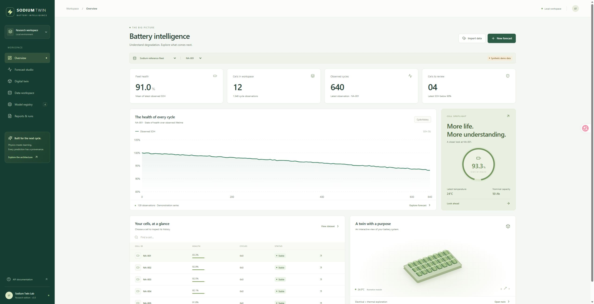
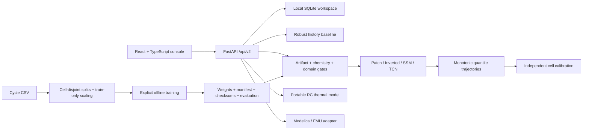

<div align="center">



# Sodium Twin

**Understand degradation. Explore what comes next.**

A battery research platform connecting modern sequence models, uncertainty-aware forecasting, and Modelica digital twins through a polished web workspace.


[Quick start](#quick-start) · [Model card](docs/MODEL_CARD.md) · [Architecture](docs/ARCHITECTURE.md) · [Validation](docs/VALIDATION.md) · [Migration](docs/MIGRATION.md)

</div>



## What this release delivers

| Workspace | Capability |
|---|---|
| **Overview** | Fleet summaries, observed SOH curves, cell selection/search, and explicit data provenance |
| **Forecast studio** | Scenario controls, trend forecasting, guarded learned inference, uncertainty, and horizon-aware RUL |
| **Digital twin** | Portable electrical/thermal simulation and the original native Modelica FMUs |
| **Data workspace** | Strict CSV validation, chemistry labels, durable imports, and a schema template |
| **Model registry** | Patch Transformer, iTransformer, selective state-space, TCN, and an interpretable baseline |
| **Reports & runs** | Persistent settings/results, full JSON records, and trajectory CSV exports |

The initial workspace contains **clearly labeled synthetic data**. No new model has been trained for this release. Learned architectures remain unavailable until a validated artifact is installed. No predictive accuracy improvement is claimed.

## Quick start

Requirements: Python 3.10+ and Node.js 20.19+ or 22.12+. Python 3.10 and Node.js 24 were used for local verification. Start from the repository root:

```powershell
python -m venv .venv
.\.venv\Scripts\Activate.ps1
python -m pip install -e ".[test]"
cd web
npm ci
npm run build
cd ..
python -m sodium_twin
```

Open **[http://127.0.0.1:8000](http://127.0.0.1:8000)**. API documentation is at **[/docs](http://127.0.0.1:8000/docs)**. The compiled UI and API share one origin and one process. The default service binds to loopback and has no login or shared administrator credentials: it is a single-user local research workspace.

Alternatively, run `./scripts/start.ps1` on Windows or `bash scripts/start.sh` on Linux/macOS. These helpers create a local environment, install the application, build the UI, and launch it. They never start training.

The review ZIP also includes `web/dist`. When using that archive, the existing compiled interface can run with just `python -m pip install -e .` followed by `python -m sodium_twin`; Node.js is only needed to rebuild the frontend. Local databases and dependency folders are excluded from the archive.

For frontend development, run `python -m sodium_twin` and `npm --prefix web run dev` in separate terminals. Vite proxies `/api` to port 8000. The UI does not depend on hosted services, external fonts, or paid inference APIs.

## Research models

| Architecture | Implemented mechanism | Status |
|---|---|---|
| Physics-guided Patch Transformer | Shared channel-wise patch attention, channel fusion, masked reconstruction auxiliary loss | Implemented; untrained |
| Inverted Transformer | Sensor histories become variate tokens; attention learns variable dependencies | Implemented; untrained |
| Selective State Space | Input-dependent diagonal transitions, causal depthwise convolution, gated scan | Implemented; untrained |
| Temporal ConvNet | Causal dilated residual convolutions | Implemented; untrained |
| Robust history baseline | Median pairwise slope, operating-stress sensitivity, explicit horizon censoring | Available |

All learned backbones share a **nonnegative cumulative degradation head** producing ordered q10/q50/q90 SOH trajectories that cannot increase over time. A discrete hazard head supports a right-censored auxiliary survival loss. Held-out cell-grouped conformal calibration does not treat repeated windows as independent cells.

These are battery-specific research implementations inspired by published work, not exact reproductions. The state-space implementation is a portable reference, **not the official fused Mamba or Mamba-2 implementation**. See the [model card](docs/MODEL_CARD.md) for equations, limitations, gates, and references.

### Prepare without training

```powershell
python -m pip install -e ".[ml]"
python -m sodium_twin.ml.train --csv data/my_cycles.csv --architecture patchtst
```

Without `--execute`, this validates data, constructs independent splits and causal windows, counts parameters, and prints a dry-run report with **zero optimizer steps**. It writes no weights. Choose `itransformer`, `selective-ssm`, or `tcn` to inspect another architecture. At least 20 cells and sufficiently long consecutive histories are required.

Actual training is documented in [TRAINING.md](docs/TRAINING.md) for later use. A checkpoint must beat persistence on the held-out test partition, pass artifact integrity checks, use measured data, and retain an independent calibration group before activation. External validation remains necessary.

## Data contract

```csv
cell_id,cycle_index,soh_pct,temperature_c,c_rate,capacity_ah
NA-001,0,100.0,25,1.0,50
NA-001,1,99.98,25,1.0,50
```

SOH uses **percent**, temperature uses **degrees Celsius**, and nominal capacity uses **Ah**. At least eight observations are required per imported cell. Non-finite values, duplicate cell/cycle pairs, missing columns, invalid IDs, and out-of-range measurements are rejected. Valid rows are sorted but never silently imputed. Browser import limits are 2 MB, 20,000 rows, and 200 cells; offline training is not subject to these upload limits.

The trend baseline supports irregular cycle spacing. Learned models require consecutive physical cycles and reject chemistry mismatch. See [DATA_CONTRACT.md](docs/DATA_CONTRACT.md).

## Physical simulation

The portable solver integrates a one-RC electrical approximation and lumped thermal balance, including current sign, SOC cutoff, cooling, and pack topology. Parameters are illustrative and uncalibrated. Its identical-cell temperatures are **not a resolved spatial thermal field**. The module graphic is a labeled schematic.

For the native FMU solver:

```powershell
python -m pip install -r requirements.txt
# Only needed when the installation is not already discoverable:
$env:OPENMODELICA_BIN = "C:\Program Files\OpenModelica\bin"
python -m sodium_twin
```

Choose **Modelica / FMU** in Digital twin. Runtime resolution checks `OPENMODELICA_BIN`, then `OPENMODELICAHOME/bin`, then `omc` on `PATH`. Compiled binaries must match the host. Files alone do not prove runtime readiness. Only 8S2P has been executed as a native integration check for this release; other topologies remain unverified.

Legacy pickled thermal weights are no longer loaded automatically. Set `SODIUM_THERMAL_MODEL` only for a trusted artifact with compatible NumPy/scikit-learn versions. The old artifact failed compatibility checks locally and was not used.

## Architecture



```text
sodium_twin/         Modern API, contracts, persistence, inference, simulation
  ml/               Encoders, physical heads, calibration, data splits, training
web/src/            React components, page modules, and design system
tests/              New API, data, model, and uncertainty tests
scripts/            Local launch helpers
docs/               Architecture, model card, migration, validation, screenshots
server.py           Compatible v1 FastAPI entry point
main.py             Retained Streamlit entry point
models/, utils/     Existing simulation, data adapters, and research tools
fmu_models/         Original compiled FMUs
mo_system_models/   Original Modelica topology sources
```

The old Streamlit/v1 workflow remains available for specialized spatial and fault studies. Its localized UI strings remain unchanged; source comments, docstrings, and project documentation are English. Historical account databases and Python bytecode are removed from the current tracked tree.

## Verification

```powershell
python -m pip install -e ".[test,ml]"
python -m pytest tests -q
# Additional dependencies for legacy regressions:
python -m pip install -r requirements.txt
python -m pytest test -q
python tools/check_english.py
npm --prefix web run build
```

Tests cover input contracts, leakage prevention, ordered/monotonic outputs, gradients, calibration rank, censoring, and API flows. They do not benchmark predictive accuracy. See [VALIDATION.md](docs/VALIDATION.md) for actual outcomes.

## Configuration and deployment

`.env.example` documents supported variables. Variables are read from the process, not automatically from `.env`. `SODIUM_DATA_DIR` controls persistence; `SODIUM_MODEL_DIR` controls validated artifacts. Relative custom paths resolve against the working directory; defaults are repository-relative.

`docker compose up --build` runs the portable platform on loopback port 8000 with persistent storage. The image excludes Windows FMUs and old research dependencies. Docker configuration is supplied but was not executed locally.

Public/multi-user deployment requires authentication, authorization, quotas, durable native workers, and a storage/privacy design. This release is a research platform, not a certified BMS or validated battery safety system.

## Attribution

The original project and Modelica/data work come from [xingxiaoyang-888/BATTERY_AGINGDETECTION](https://github.com/xingxiaoyang-888/BATTERY_AGINGDETECTION). Git history is retained. Research sources and implementation differences are documented in the [model card](docs/MODEL_CARD.md). Dataset licenses and citations remain with their providers. No new blanket license is imposed on the existing project or datasets.
